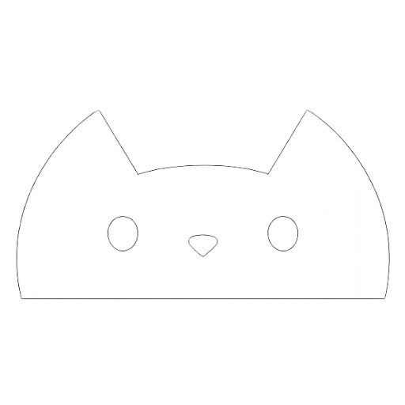

  

# Stray Alley (ARCHIVED) [PLEASE USE THE [BROWSER MODE](https://stray-web.onrender.com) WITH LATEST UPDATES AND FIXES.]
## No support will be provided for Alley! Support is only available for Browser mode through our discord server.

Stray Alley is a self-hosted, secure Discord presence playground built on Next.js. It features active session device spoofing, custom rich activity presence, client connection management, automatic quest completion, and Discord profile badge spoofing.

> [!WARNING]
> **Violation of Discord Terms of Service (ToS):** Operating selfbots or custom presence scripts on personal user accounts is against the Discord Terms of Service. Using this project could result in your account being permanently banned or restricted. Use at your own risk.

> [!CAUTION]
> **Keep Your Token Safe:** Your Discord Account Token gives full access to your account. Stray Alley encrypts your token locally in `db.json` using AES-256-GCM (automatically generating encryption keys on start), but you must ensure your host environment remains secure. Never share your token.

---

## Documentation

To install, configure, or troubleshoot Stray Alley, navigate to the documents below:

* **[Installation and Setup Guide](SETUP.MD):** Step-by-step local setup, cloud deployments (Render, Railway, etc.), and UptimeRobot keep-alive setup.
* **[Changelog](CHANGELOG.MD):** Detailed version history and features summary.

---

## Preview

  

## Credits

* **Base Client:** Stray's gateway core is built using connection payloads inspired by the [Ghost-Selfbot](https://github.com/ghostselfbot/ghost) project. Massive thanks to the original creator.
* **Auto-Quest Complete (DQACS):** Stray's Auto-Quest Complete is built using [DQACS](https://github.com/aiko-chan-ai/Discord-Quest-Auto-Completion-Selfbot). Massive thanks to the original creator.
* **Discord Badge Spoofer (DBS):** Stray's Badge Spoofer is built using [DBS](https://github.com/revere-group/discord-badge-spoofer). Massive thanks to the original creator.

---

## License

Stray is licensed under the **PolyForm Noncommercial License 1.0.0**. See the `LICENSE.MD` file for details.

